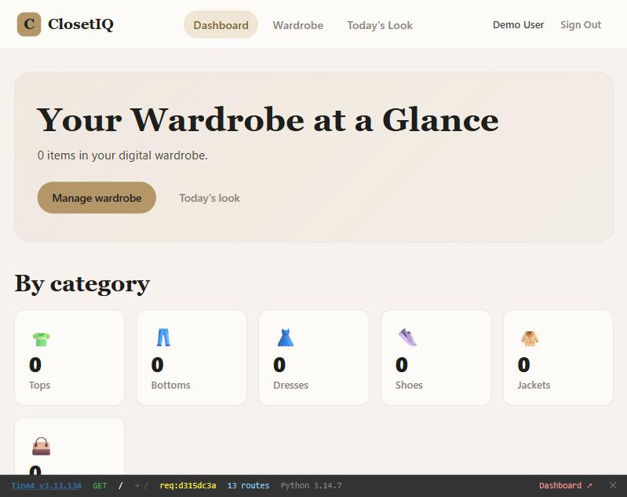
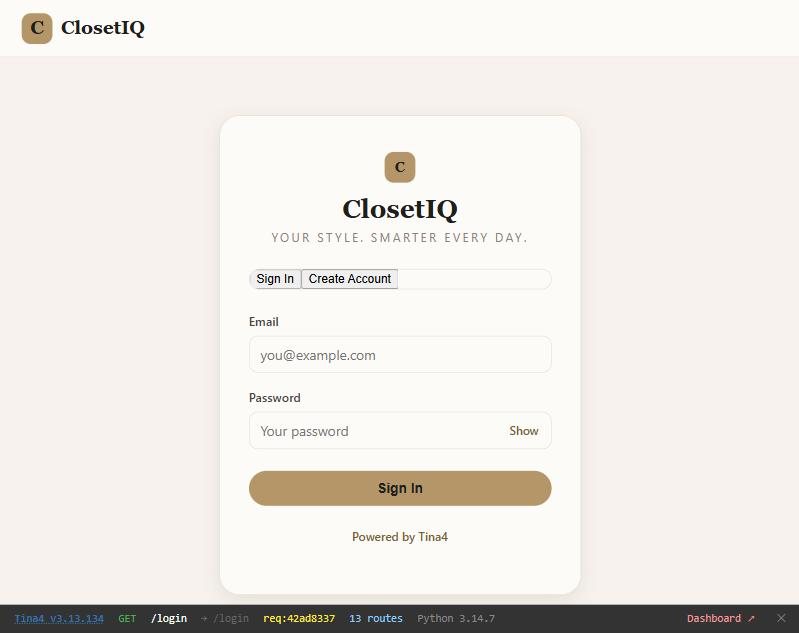
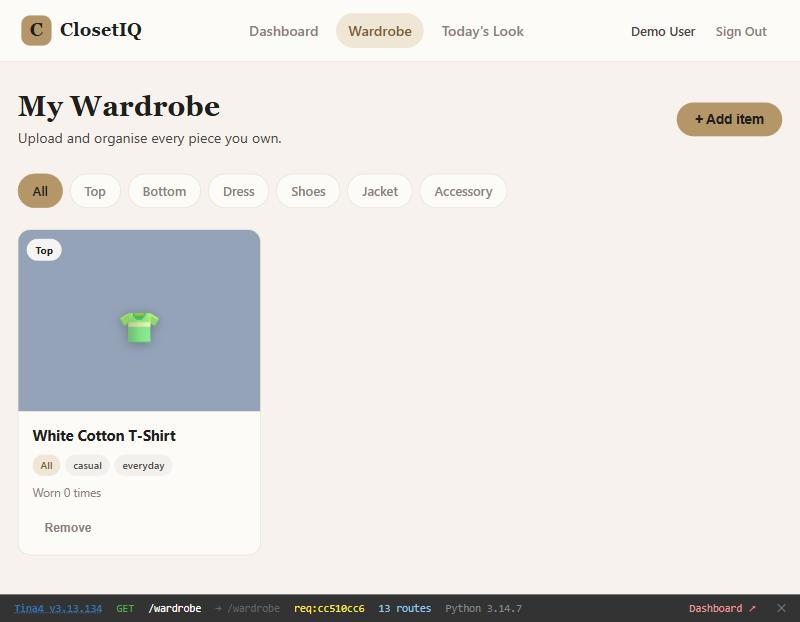
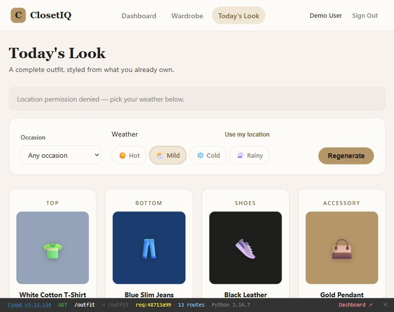

# ClosetIQ

**Your Style. Smarter Every Day.**

ClosetIQ is a smart digital wardrobe and outfit planner. Upload your clothes, organise them by category, and let the app generate complete outfits based on weather, occasion, and your personal style.



## Features

- **Digital wardrobe** — add items with name, category, season, colour, style tags, and optional photo
- **Category filters** — browse by Tops, Bottoms, Dresses, Shoes, Jackets, Accessories
- **Outfit generator** — get a complete look (top + bottom + shoes + accessory) picked from your wardrobe
- **Weather-aware** — hot, mild, cold, or rainy; cold weather adds a jacket slot. Auto-detects your local weather
- **Occasion filter** — casual, formal, smart-casual, date, work
- **User accounts** — register/login with email and password; each user's wardrobe is private
- **PWA-ready** — installable on mobile with offline support
- **Responsive** — works on desktop and mobile

## Tech Stack

- **[Tina4 Python](https://tina4.com)** v3 — zero-dependency web framework
- **SQLite** — no database server needed (supports PostgreSQL/MySQL for production)
- **Frond** — built-in Twig-compatible template engine
- **SCSS** — custom design system (cream, gold, charcoal palette)

## Quick Start

```bash
# Clone
git clone https://github.com/Christine6902/closetiq.git
cd closetiq

# Install
uv sync

# Run
tina4 serve
```

The app opens at `http://localhost:7145`. Register an account and start adding your wardrobe.

## Project Structure

```
app.py                  # ASGI entry point
src/
  routes/               # API and page routes
    auth.py             #   login, register, logout
    home.py             #   dashboard
    wardrobe.py         #   wardrobe CRUD
    outfit.py           #   outfit generator
    weather_api.py      #   live weather API
  orm/                  # Database models
    User.py
    WardrobeItem.py
  app/                  # Business logic
    auth_helpers.py
    outfit_engine.py
    weather.py
  templates/            # Frond/Twig templates
  scss/                 # Stylesheets
  public/               # Static assets, JS, icons, PWA
migrations/             # Database migrations (auto-run on start)
design/                 # Brand guidelines and UI guide
```

## Deployment

Ready-to-deploy configs are included for:

- **Docker** — `Dockerfile` (run `docker build -t closetiq . && docker run -p 8000:8000 closetiq`)
- **Render** — `render.yaml` (connect your GitHub repo)
- **Railway** — `railway.toml`
- **Any ASGI host** — `Procfile` / `uvicorn app:app`

Set these environment variables in production:

| Variable | Required | Description |
|---|---|---|
| `TINA4_SECRET` | Yes | JWT/session signing key (random 64+ chars) |
| `TINA4_DATABASE_URL` | Yes | `sqlite:///data/app.db` or a PostgreSQL URL |
| `TINA4_DEBUG` | No | `false` in production |
| `TINA4_NO_BROWSER` | No | `true` on servers |

See `.env.production` for a full template.

## Documentation

- [User Manual](ClosetIQ-User-Manual.docx) — step-by-step how-to guide with screenshots
- [Test Report](ClosetIQ-Test-Report.docx) — 78 tests, all passing
- [Brand Guidelines](design/brand-guidelines.html) — colours, typography, logo
- [UI Guide](design/ui-guide.html) — component library

## Screenshots

| Login | Wardrobe | Outfit Generator |
|---|---|---|
|  |  |  |

---

Built with [Tina4](https://tina4.com) — Simple. Fast. Human.
